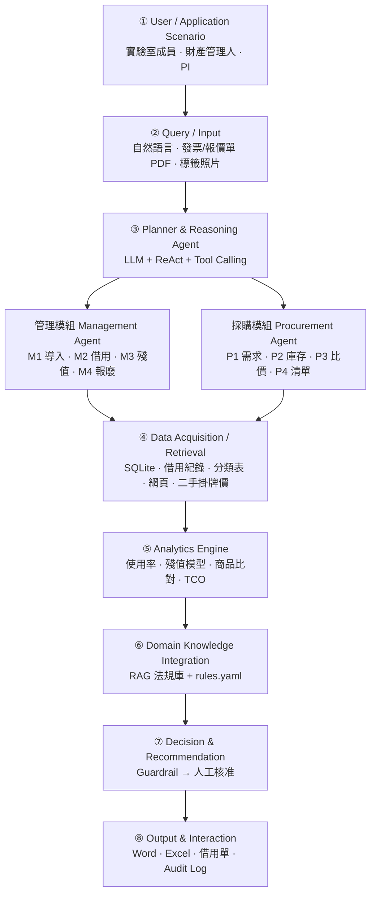
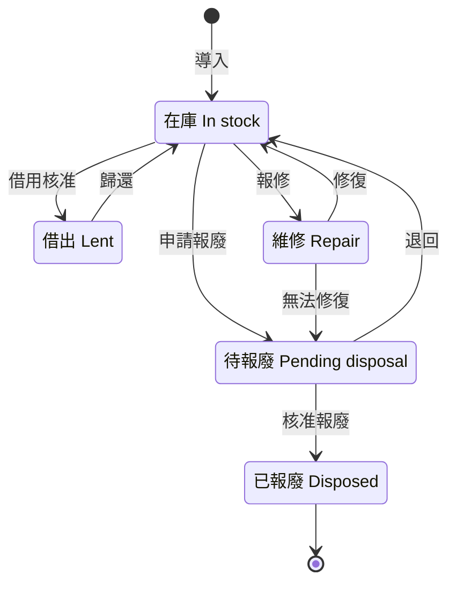
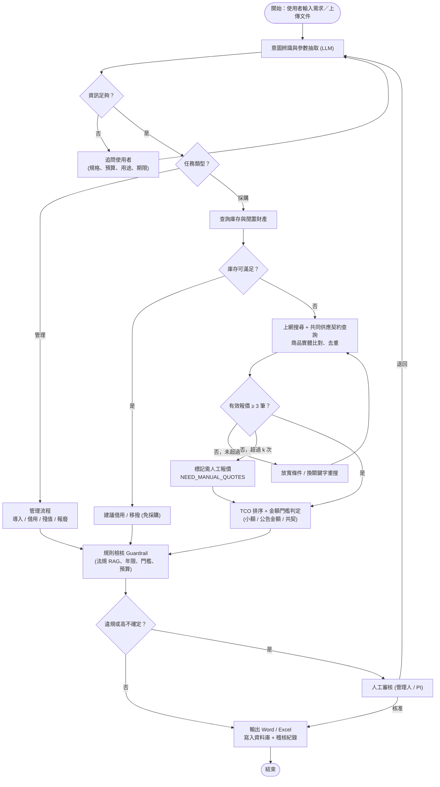

# LabSteward — DESIGN.md

> **實驗室財產管理 AI Agent｜An AI Agent for Laboratory Asset Management & Procurement**

| 項目 | 內容 |
| --- | --- |
| 專案階段 | Proposal（尚未實作；本文件隨專案持續維護） |
| 文件版本 | v0.2（2026-11） |
| 系所 | 資訊工程學系 |
| 組員 | 潘兆邠、邱冠霖、林浚偉、張皓崴、黃翊豪 |
| 對應文件 | Proposal Document（PDF）、Proposal PPT、`README.md` |

**文件約定**

- 標示 **【提案】** 的內容直接來自 Proposal；標示 **【草案】** 的內容是為了讓設計可實作而補充的初版設計，**尚待團隊確認**。
- 標示 **TBD** 代表尚未決定或尚無資料，**不是**已完成的結果。
- 本專案目前**尚未進行實驗**，第 11 章的結果欄位刻意留空，所有成果皆為 *Expected Outcomes*。
- 方括號編號（如 [4]）對應第 14 章參考文獻。

**閱讀順序（讓下一位開發者可以接手）**

`Problem → Requirements → Architecture → Components → Data → AI/Analytics → Domain Knowledge → Algorithm → Implementation → How to Run → Results → Limitations`

## 目錄

1. [Problem：問題與使用者](#1-problem問題與使用者)
2. [Requirements：需求](#2-requirements需求)
3. [Architecture：系統架構](#3-architecture系統架構)
4. [Components：元件說明](#4-components元件說明)
5. [Data：資料與資料流](#5-data資料與資料流)
6. [AI / Analytics：AI 與分析方法](#6-ai--analytics-ai-與分析方法)
7. [Domain Knowledge：領域知識](#7-domain-knowledge領域知識)
8. [Algorithm：核心演算法與流程](#8-algorithm核心演算法與流程)
9. [Implementation Mapping：實作對應](#9-implementation-mapping實作對應)
10. [How to Run：執行方式](#10-how-to-run執行方式)
11. [Experiments & Results：實驗與結果](#11-experiments--results實驗與結果)
12. [Limitations & Open Questions：限制與待決事項](#12-limitations--open-questions限制與待決事項)
13. [Security, Privacy & Compliance](#13-security-privacy--compliance)
14. [References：參考文獻](#14-references參考文獻)
15. [Changelog](#15-changelog)

---

## 1. Problem：問題與使用者

### 1.1 為什麼值得做【提案】

大學實驗室持有大量以公帑購置的儀器與資訊設備，但「買了不用、用了不登記、壞了不報廢」的情形長期存在。

| 證據 | 來源 |
| --- | --- |
| 監察院 2013 年調查國科會補助貴重儀器：8 所國立大學使用率偏低，部分核心設施全年服務次數不到 100 次，補助計畫結束後缺乏退場與營運機制 | [2] |
| 韓國 2026 年 5 月提出研究基礎設施開放政策：全國設備系統登錄 93,480 件研究設備，大學持有 22,335 件（約 24%），並轉向全校共享制度 | [1] |
| 採購端 AI 化：Deloitte 2026 調查指出 92% 採購長正在評估或試行 Agentic AI；Hackett 指出 2024 年 49% 採購團隊試行 AI，僅 4% 大規模部署 | [3] |

「有需求、有技術，但落地困難」是目前的狀態。

### 1.2 要解決的四個問題【提案】

| # | 問題 | 具體例子 |
| --- | --- | --- |
| P1 | **資訊斷裂**：財產清冊、借用紀錄、採購文件分散在 Excel、紙本與學校系統 | 無法回答「實驗室現在有哪些可借的 GPU 主機？」 |
| P2 | **價值不透明**：帳面價值只反映法定年限 | 無法回答「三年前買的示波器現在還值多少？要修還是要換？」 |
| P3 | **先買再說**：請購前缺乏強制「先查庫存、閒置、可移撥財產」的步驟 | 導致重複購置 |
| P4 | **法規門檻高**：不熟悉金額門檻、報價份數、最低使用年限、報廢分級核定 | 文件常被退件 |

### 1.3 現有方法的不足【提案】

| 現有方法 | 不足 |
| --- | --- |
| 校內財產系統 | 以登帳與盤點為主，缺乏自然語言查詢、殘值估算、採購決策支援 |
| 商用採購 AI（如 SAP、Zycus） | 為企業流程設計，未內建台灣政府採購法與公立學校財物規範；對單一實驗室過於昂貴 |
| 通用 LLM 聊天機器人 | 數值與法規容易幻覺；LLM 端到端求解成本較高（約多 32%）[4]；多步驟工具任務穩定度不足（τ-bench retail pass^8 < 25%）[6] |
| 網購比價 Agent | 多屬性、篩選、排序成功率低 [5]；商品比對對 prompt 敏感 [7] |
| 殘值預估研究 | 多集中於重型機具、汽車、手機 [10][11]，較少處理「交易資料稀少、規格差異大」的實驗儀器 |

**Research Gap**：缺少一個「懂台灣公立學校財物與採購法規、能先查庫存再比價、能估殘值、且可稽核」的實驗室層級 Agent。

### 1.4 使用者【提案】

| 角色 | 主要任務 |
| --- | --- |
| 實驗室成員 | 查詢設備、借用設備、提出請購 |
| 財產管理人／助理 | 財產導入、盤點、報廢 |
| 指導教授（PI） | 核准採購與報廢 |

### 1.5 範圍與非目標【草案】

- **範圍內**：實驗室層級的財產導入、借用／租用、殘值預估、報廢草稿，以及採購前的庫存查詢、比價、門檻判定與採購清單產出。
- **非目標**：(a) 不取代學校正式財產管理系統；(b) 不自動下單、不自動送出報廢，具法律效力的動作一律由人核准；(c) 不提供法律意見，只引用規則並標示來源。

---

## 2. Requirements：需求

### 2.1 功能需求（Functional Requirements）

| ID | 需求 | 對應模組 |
| --- | --- | --- |
| FR-01 | 從發票／報價單（PDF）擷取品名、規格、金額、日期，並建議財物分類 | M1 導入 |
| FR-02 | 建立借用／租用單，檢查時段衝突，到期提醒 | M2 借用 |
| FR-03 | 計算帳面價值與市場價值（含區間），並建議「繼續使用／維修／移撥／報廢」 | M3 殘值 |
| FR-04 | 檢核報廢年限與狀態，產生報廢申請草稿 | M4 報廢 |
| FR-05 | 以追問方式確認需求（用途、規格、數量、預算、期限） | P1 確認需求 |
| FR-06 | 請購前**強制**查詢在庫、閒置、可移撥財產；可滿足時建議借用／移撥 | P2 查詢庫存 |
| FR-07 | 搜尋電商與共同供應契約，做商品實體比對與去重 | P3 比價 |
| FR-08 | 依金額判定採購流程，輸出含報價來源的採購清單；偵測拆單 | P4 採購清單 |
| FR-09 | 自然語言查詢財產清冊與借用狀態 | ②③④ |
| FR-10 | 每項建議附上法規條文或資料來源引用 | ⑥⑦ |
| FR-11 | 所有會改變帳務狀態的動作需人工核准並寫入稽核紀錄 | ⑦⑧ |
| FR-12 | 輸出 Word 採購清單／報廢申請草稿、Excel 財產清冊、借用單與通知 | ⑧ |
| FR-13 | 依角色授權可用工具（RBAC） | ① |

### 2.2 非功能需求（Non-functional Requirements）

| ID | 需求 | 衡量方式 |
| --- | --- | --- |
| NFR-01 | **正確性**：金額門檻、年限、折舊由確定性程式計算，不交給 LLM 判斷 | 法規違規率、殘值 MAPE |
| NFR-02 | **穩定性**：同一任務重跑多次結果一致 | pass^k（k = 4） |
| NFR-03 | **可稽核**：每個決策可追溯輸入、引用條文、核准人 | Audit Log 完整性、證據正確性 |
| NFR-04 | **可設定**：金額與年限門檻放在規則檔，法規修訂時不改程式 | `knowledge/rules.yaml` |
| NFR-05 | **可交接**：他人可透過 GitHub + README + DESIGN.md 理解、執行、驗證 | 新成員依文件可重現 Demo |
| NFR-06 | **隱私**：只使用去識別化或合成資料上傳公開儲存庫 | 見第 13 章 |
| NFR-07 | **效率**：縮短行政作業時間 | 作業時間（輸入到產出文件） |

---

## 3. Architecture：系統架構

### 3.1 設計原則【提案】

1. **LLM 協調，工具計算**：LLM 只負責理解需求、追問、拆解任務、選擇工具、解釋結果；金額門檻、年限、折舊、拆單偵測交給確定性程式與規則引擎。依據 [4]：LLM 端到端求解有 *hallucination tax*，混合式架構成本降低 32.1%。
2. **先共享，再採購**：採購流程第一步強制查庫存。
3. **合規與分級授權**：門檻寫成可設定規則檔，由規則引擎判定。
4. **帳面價值 ≠ 經濟價值**：殘值同時輸出兩軌，並把「繼續使用／維修／移撥／報廢」當選項。
5. **人在迴路**：具法律效力的動作需人工核准，並留下稽核紀錄。

### 3.2 八階段架構圖【提案】



### 3.3 各階段說明【提案】

| 編號 | 模組 | 說明 |
| --- | --- | --- |
| ① | User / Application Scenario | 三類使用者；依角色授權不同工具（RBAC） |
| ② | Query / Input | 自然語言、發票／報價單 PDF、財產標籤照片；介面先以 Web（Streamlit）實作，可延伸至 LINE Bot |
| ③ | Planner & Reasoning Agent | LLM 以 ReAct 辨識意圖、抽取參數、資訊不足時追問，分派給「管理子 Agent」或「採購子 Agent」，輸出前自我檢核 |
| ④ | Data Acquisition / Retrieval | SQLite 財產資料庫與借用紀錄、財物標準分類表、網頁搜尋與擷取（Playwright）、二手市場掛牌價 |
| ⑤ | Analytics Engine | 使用率／閒置分析、殘值迴歸模型（log-linear／Gradient Boosting）、商品實體比對（規格欄位 + LLM）、總持有成本 TCO 排序 |
| ⑥ | Domain Knowledge (RAG) | 財物管理辦法、財物標準分類、報廢分級、校內請購規範切塊建立向量索引（BM25 + 向量混合），門檻與年限另寫成 YAML 規則檔 |
| ⑦ | Decision & Recommendation | Guardrail 規則檢核（門檻、年限、預算、拆單），附證據引用與不確定度；高風險或違規轉人工審核 |
| ⑧ | Output & Interaction | Word 採購清單／報廢申請草稿、Excel 財產清冊、借用單與通知，並寫入稽核紀錄 |

---

## 4. Components：元件說明

### 4.1 Planner Agent（③）【提案】

- 以 ReAct 在「推理」與「呼叫工具」之間交錯 [12]。
- 職責：意圖辨識、參數抽取、追問（上限 `T_max` 輪）、任務拆解、工具選擇、輸出前自我檢核。
- **不得**：自行計算金額門檻／折舊、自行判定法規是否合規、直接寫入資料庫。

### 4.2 管理子 Agent（M1–M4）【提案】

| 模組 | 功能 | 主要輸入 | 主要輸出 |
| --- | --- | --- | --- |
| M1 導入 | 從發票／報價單 OCR 抽取品名、規格、金額、日期，建議財物分類 | PDF、照片 | 財產建檔草稿 |
| M2 借用／租用 | 檢查時段衝突、建立借用單、到期提醒 | 設備、時段、借用人 | 借用單、提醒通知 |
| M3 殘值 | 計算雙軌殘值（見 6.2） | 設備資料、購置價、年數、狀況 | 帳面價值、市場價值區間、建議 |
| M4 報廢 | 檢核最低使用年限與狀態，產生報廢申請草稿 | 設備、狀態 | 報廢申請草稿 |

### 4.3 採購子 Agent（P1–P4）【提案】

| 模組 | 功能 |
| --- | --- |
| P1 確認需求 | 追問用途、規格、數量、預算、期限，並正規化規格 |
| P2 查詢庫存 | 查詢在庫、閒置、可移撥財產；可滿足則建議借用／移撥 |
| P3 上網比價 | 搜尋電商與共同供應契約；商品實體比對與去重；有效報價不足 3 筆時放寬條件重搜 |
| P4 採購清單 | 依總持有成本排序、依金額判定流程、偵測拆單、輸出含報價來源的清單 |

### 4.4 規則引擎與 Guardrail（⑦）【提案】

- 讀取 `knowledge/rules.yaml`，以確定性程式檢核：財產／物品判定、金額門檻、最低使用年限、預算、拆單。
- LLM 僅負責用自然語言解釋判定結果，**不參與判定**。
- 觸發人工審核的條件（Algorithm 1 第 13 行）：有違規、不確定度高於 `τ`，或動作會改變帳務狀態。

### 4.5 領域知識庫（⑥）【提案】

見第 7 章。採混合檢索（BM25 + 向量）[9]，另加數值過濾。

### 4.6 輸出與稽核（⑧）【提案】

- 文件：Word（python-docx）、Excel（openpyxl）。
- Audit Log：記錄輸入、輸出、引用證據、規則檢核結果、核准決定與時間。

### 4.7 角色與權限（RBAC）【草案】

| 動作 | 實驗室成員 | 財產管理人 | PI |
| --- | :---: | :---: | :---: |
| 查詢庫存／借用狀態 | ✔ | ✔ | ✔ |
| 提出借用 | ✔ | ✔ | ✔ |
| 提出請購（產生草稿） | ✔ | ✔ | ✔ |
| 財產導入、盤點 | — | ✔ | — |
| 殘值估算 | — | ✔ | ✔ |
| 報廢申請（產生草稿） | — | ✔ | — |
| 核准採購／報廢 | — | — | ✔ |

### 4.8 工具清單【草案】

> Proposal 的貢獻列表提到「8 項工具」，但未逐項列出。下表為依 M1–M4、P1–P4 整理的初版，**實作時請團隊確認**。

| 工具 | 用途 | 對應模組 |
| --- | --- | --- |
| `ingest_document` | OCR 與欄位抽取、分類建議 | M1 |
| `lending` | 借用單建立、衝突檢查、提醒 | M2 |
| `valuation` | 雙軌殘值估算 | M3 |
| `disposal` | 報廢檢核與草稿產生 | M4 |
| `query_inventory` | 在庫／閒置／可移撥查詢 | P2、FR-09 |
| `web_search` | 電商與共同供應契約搜尋（Playwright + 搜尋 API） | P3 |
| `entity_match` | 商品實體比對與去重 | P3 |
| `docgen` | Word／Excel 文件輸出 | P4、M4、M2 |

---

## 5. Data：資料與資料流

### 5.1 資料來源【提案】

| 資料 | 來源 | 用途 | 備註 |
| --- | --- | --- | --- |
| 財產清冊 | 本實驗室去識別化清冊 | 庫存查詢、使用率、殘值 | 公開儲存庫僅放去識別化／合成資料 |
| 借用紀錄 | 合成資料 + 系統產生 | 衝突檢查、使用率 | |
| 財物標準分類表 | 《財物標準分類》[14] | 最低使用年限 L、分類 | `knowledge/std_class_table.csv` |
| 二手市場掛牌價 | 二手平台（筆電、螢幕、GPU、量測儀器） | 市場價值模型 | 掛牌價非成交價 |
| 法規與校內規範 | [13][14][15][17] | RAG 知識庫、規則檔 | |
| 情境測試集 | 人工標註 | 評估 | 約 50 題 |

### 5.2 資料表初版【草案】

```sql
-- 僅為設計草案，實作時以 db/schema.sql 為準
assets(asset_id, name, spec, category_code, unit_price, purchase_date,
       status, custodian, location, working, utilization_30d)
lending(lend_id, asset_id, borrower, start_ts, end_ts, returned_ts)
market_listings(listing_id, category_code, spec, ask_price, listed_at, condition)
std_class(category_code, name, min_life_years)
audit_log(log_id, ts, actor, role, intent, input, output, evidence, violations, decision)
```

### 5.3 財產狀態機【提案】＋轉移細節【草案】

非法狀態轉移由工具直接拒絕（「帳實相符」「全生命週期」兩項思維的落實）。



### 5.4 資料流

`使用者輸入（②）→ Planner（③）→ 子 Agent 呼叫工具（④）→ 分析（⑤）→ 規則檢核與 RAG 引用（⑥⑦）→ 人工核准（必要時）→ 寫入資料庫與 Audit Log → 輸出文件（⑧）`

寫入資料庫的唯一路徑是「工具 + 人工核准 + 稽核紀錄」；Agent 不能「口頭」改帳。

---

## 6. AI / Analytics：AI 與分析方法

### 6.1 LLM 與 Agent 框架【提案】

| 項目 | 選用 | 理由 |
| --- | --- | --- |
| LLM | Claude／GPT 系列 API（支援 Tool Calling） | 原生函式呼叫、長上下文，可處理法規條文 |
| Agent 框架 | LangGraph 或自行實作狀態機 | 可明確控制流程、迴圈上限與人工核准節點 |
| 推理模式 | ReAct [12]；Agentic RAG [8] | 推理與行動交錯；由 Agent 決定檢索策略 |

### 6.2 雙軌殘值估計（M3）【提案】

**帳面價值（法定）**：直線法

```latex
V_{book}(t) = C \times \max\left(0,\ 1 - \frac{t}{L}\right)
```

`C` 取得成本、`t` 已使用年數、`L` 該類財產之最低使用年限（由財物標準分類表查得；校方若採不同公式可在設定檔替換）。

**市場價值（經濟）**：

```latex
V_{mkt}(t) = C \times (1 - d)^{t} \times q
```

- `d`：年貶值率，以同類別二手掛牌資料做 log-linear 迴歸估計（參考 [11]）。
- `q`：狀況係數（正常／小瑕疵／故障）。
- 資料量足夠的類別改用 Gradient Boosting，並以 bootstrap 產生 **80% 預測區間**。
- 資料不足時退回類別預設值，並標示 **低信心（LOW_CONFIDENCE）**。

**輸出**：兩種價值與區間、差異說明，以及「繼續使用／維修／移撥／報廢」的建議與依據。

**建議規則**（Algorithm 2）：年限到仍可用 → 繼續使用；無法運作且維修費高於市場價值上界 → 報廢；使用率低於 `u_min` → 移撥或共享；其餘 → 維修或保留。

> 參數 `N_min`、`u_min`、`δ`、各類別預設 `d` 皆 **TBD**，待資料蒐集後決定（見第 12 章）。

### 6.3 商品實體比對（P3）【提案】

- 以結構化規格欄位做二次驗證，再用 LLM 判斷是否為同一商品；**不只靠 LLM**，因為 LLM 對 prompt 寫法高度敏感 [7]，且購物 Agent 在篩選／排序上易出錯 [5]。
- 去重後以 TCO 排序：`TCO(price, warranty, shipping, lead_time)`（權重 TBD）。

### 6.4 混合檢索（⑥）【提案】

BM25 + 向量檢索（FAISS／Chroma）+ 數值過濾，用於法規條文與財產資料 [9]。每個建議必須附上引用的條文或資料來源。

### 6.5 使用率分析【提案】

依借用紀錄計算設備使用率與閒置狀態，用於「先查庫存」、移撥／共享建議與殘值建議。

### 6.6 分析套件

pandas、scikit-learn、LightGBM（殘值迴歸與使用率分析）。

---

## 7. Domain Knowledge：領域知識

### 7.1 關鍵規則【提案】

| 規則 | 內容 | 來源 |
| --- | --- | --- |
| 財產定義 | 單價 NT$10,000 以上且使用年限 2 年以上為「財產」，未達者為「物品」 | [13][14] |
| 最低使用年限 | 正常使用下的最低年限；**達到年限不代表應報廢**，仍可使用者應延後報廢 | [14] |
| 提前報廢 | 未達年限而損壞無法修復者，得依程序專案報廢 | [14] |
| 報廢核定 | 依損失金額分級核定；後續處分依《各機關奉准報廢財產之變賣及估價作業程序》 | [13][17] |
| 小額採購 | NT$150,000 以下，經單位主管核准即可逕洽廠商（以臺大請購規範為例） | [15] |
| 公告金額 | NT$1,500,000 以上，請購時須附價格分析 | [15] |
| 其他門檻 | 另有查核金額、巨額採購門檻；共同供應契約透過電子採購系統下訂 | [15] |

> 各校細節不同，因此所有門檻須做成**可設定的規則檔**，不可寫死在程式中。

### 7.2 規則檔初版【草案】

```yaml
# knowledge/rules.yaml （草案；數值請與校方規範核對後再定案）
version: 0.1
institution: TBD            # 例如各校名稱；不同學校可替換
asset_definition:
  min_unit_price_twd: 10000       # [13][14]
  min_service_life_years: 2       # [13][14]
procurement:
  small_purchase_max_twd: 150000          # [15] 以臺大請購規範為例
  announcement_threshold_twd: 1500000     # [15]
  audit_threshold_twd: TBD                # 查核金額
  major_procurement_threshold_twd: TBD    # 巨額採購
  require_price_analysis_at_or_above_announcement: true   # [15]
agent_policy:                              # 系統設計參數，非法規
  min_valid_offers: 3                      # 有效報價不足 3 筆則放寬條件重搜
  max_relax_iterations: TBD                # K_max
  split_order_window_days: TBD             # 拆單偵測的比對期間
  uncertainty_threshold: TBD               # τ
approvals:
  require_human_for: [purchase_commit, disposal_commit, asset_state_change]
```

### 7.3 五個核心思維模式 → 設計決策【提案】

| # | 思維模式 | 意義 | 證據 | 對系統設計的影響 |
| --- | --- | --- | --- | --- |
| 1 | **帳實相符** Record = Reality | 帳上每件財產都找得到、對得上保管人與位置 | 財物管理辦法明定保管人責任、盤點與減損程序 [13] | 所有寫入經工具並留稽核紀錄；Agent 不能口頭改帳；支援財產標籤 QR 碼盤點 |
| 2 | **全生命週期** Lifecycle | 取得、使用、維護、移轉到報廢／變賣是一條完整鏈 | 法規分別規範取得、減損、報廢、讓與與變賣估價 [13][17] | 以狀態機管理每件財產，非法轉移直接拒絕 |
| 3 | **先共享，再採購** Utilize before Acquire | 採購前先確認既有或閒置資源 | 低使用率儀器 [2]；韓國轉向共享制度 [1] | 採購第一步強制 `query_inventory()` |
| 4 | **合規與分級授權** Compliance by Threshold | 金額、年限不同則流程與核准層級不同 | 1 萬／2 年定義 [13]；小額 15 萬、公告 150 萬 [15]；報廢分級 [13] | 門檻寫成 YAML 規則檔，由規則引擎判定，LLM 只解釋 |
| 5 | **帳面價值 ≠ 經濟價值** Book vs. Economic Value | 法定年限是會計與管理工具，不代表實際價值 | 年限已到仍可用者不應報廢 [14]；筆電年貶值約 14.4% [11]；GPU 年限爭議 [16] | 同時輸出帳面與市場估值區間，建議多選項 |

### 7.4 三個專業爭論 → 設計決策【提案】

| 爭論 | 觀點 A ↔ 觀點 B | 目前共識 | 對本系統的決定 | 未解問題 |
| --- | --- | --- | --- | --- |
| 折舊年限 | 法定／會計年限（雲端業者 GPU 採 6 年）↔ 實際經濟壽命（技術週期約 12–18 個月）[11][16] | 會計年限是政策選擇，須揭露；汰換決策另看經濟價值 | 雙軌殘值 | 實驗儀器缺乏二手成交資料，如何可靠估計經濟價值？ |
| 設備歸屬 | 集中共享 ↔ 實驗室自有 [1][2] | 高價低頻設備走共享；低價高頻設備留實驗室，但需借用紀錄與使用率可見性 | 借用登記 → 使用率分析 → 採購前查庫存 | 成本回收（使用費）如何訂？PI 轉校時設備如何移轉？ |
| AI 自主程度 | 全自動 Agentic Procurement（Bain：生產力可提升 60% 以上；Gartner：2028 年 90% B2B 採購由 Agent 中介）↔ Human-in-the-loop（Gartner：2027 年底前超過 40% Agentic AI 專案將被取消；Hackett：僅 4% 大規模部署）[3][4][6] | LLM 當介面與協調者，關鍵計算交給確定性工具，具法律效力的動作需人工核准 | 下單、報廢一律人工核准 | Agent 出錯的責任歸屬？如何讓 LLM 推理過程達到稽核要求？ |

### 7.5 十個深度理解問題 → 測試情境來源【提案】

下列 10 題同時是情境測試集的種子題（各自展開為可自動評分的情境）。

| # | 層次 | 問題 |
| --- | --- | --- |
| 1 | Why | 為什麼財產門檻要同時看金額與使用年限？只看金額會出什麼問題？ |
| 2 | What-if | 已超過最低使用年限、仍可正常運作的示波器，PI 想換新機，系統應如何建議？為什麼不能直接建議報廢？ |
| 3 | Trade-off | 採購 14 萬與 16 萬的設備，流程差異是什麼？何時多花錢反而更划算？ |
| 4 | Failure Case | 比價 Agent 找到比市價便宜 40% 的商品，可能是哪些原因？系統應如何處理？ |
| 5 | Evidence | 如何證明實驗室「真的需要」再買一台 GPU 主機，而不是使用率不足？ |
| 6 | Comparison | 直線法與指數型（定率）折舊分別適合哪些設備？各自在哪個階段讓殘值高估或低估？ |
| 7 | Design Decision | 為什麼金額門檻判定用規則引擎而不是讓 LLM 讀法規後判斷？法規修訂時維護成本有何不同？ |
| 8 | Real-world | 學生畢業離校，名下保管 3 件財產且 1 件借出未還，系統應觸發哪些流程？ |
| 9 | What-if | 同一需求被拆成兩張 8 萬元請購單，可能違反什麼原則？Agent 如何偵測？ |
| 10 | Trade-off | 借用登記越嚴格資料越完整，但使用者越可能不登記，如何取捨？ |

---

## 8. Algorithm：核心演算法與流程

### 8.1 流程圖【提案】



**流程重點**：(1) 資訊不足回到追問迴圈；(2) 採購必經庫存查詢，可滿足時直接轉借用／移撥；(3) 有效報價不足 3 筆時放寬條件重搜，超過 k 次標記人工處理；(4) 所有路徑最後都經 Guardrail，違規或高不確定時進入人工審核，退回則回到意圖辨識。

> 超過 k 次標記人工報價後，仍以現有報價排序（修訂版 Proposal 已同步）。

### 8.2 Algorithm 1：LabSteward Agent（Main Loop）【提案，v0.2 修訂】

```text
Algorithm 1: LabSteward Agent (Main Loop)
Input : user query Q, user role r, attachments F
Output: result R with evidence E and audit record A

01: intent, params <- LLM.parse(Q, F)
02: if not authorized(r, intent) then return Deny("permission")
03: while missing(params, intent) and turns < T_max do
04:     params <- params + ask_user(clarify_questions(intent, params))
05: end while
06: if intent in {IMPORT, LEND, VALUE, DISPOSE} then
07:     R <- ManagementAgent(intent, params)
08: else if intent = PROCURE then
09:     R <- ProcurementAgent(params)          // Algorithm 3
10: end if
11: E <- KB.retrieve(intent, R)               // regulation citations
12: violations <- RuleEngine.check(R, rules.yaml)
13: if violations != {} or R.uncertainty > tau or R.commits_state then
14:     decision <- human_review(R, E, violations)
15:     if decision = REJECT then
16:         if retries >= R_max then return Escalate(R, E)
17:         return LabSteward(Q + feedback, retries + 1)
18:     end if
19: end if
20: commit(R); A <- audit_log(Q, R, E, decision)
21: return render_docs(R, E)                 // Word / Excel
```

### 8.3 Algorithm 2：Dual-track Residual Value Estimation（M3）【提案】

```text
Algorithm 2: Dual-track Residual Value Estimation (M3)
Input : asset a (cost C, category k, purchase date, condition c)
Output: book value Vb, market value interval [Vl, Vh], advice

01: t <- years_since(a.purchase_date)
02: L <- StdClassTable.min_life(k)            // 最低使用年限
03: Vb <- C * max(0, 1 - t / L)
04: D <- MarketData.listings(similar_to(a))
05: if |D| >= N_min then
06:     model <- GBM.fit(D); [Vl, Vh] <- bootstrap_interval(model, a)
07: else
08:     d <- LogLinear.fit(category_data(k)).rate or default_rate(k)
09:     Vm <- C * (1 - d)^t * q(c); [Vl, Vh] <- Vm * (1 -/+ delta)
10:     flag LOW_CONFIDENCE
11: end if
12: if t >= L and a.working then advice <- KEEP_USING   // 年限到仍可用
13: else if not a.working and repair_cost(a) > Vh then advice <- DISPOSE
14: else if utilization(a) < u_min then advice <- TRANSFER_OR_SHARE
15: else advice <- REPAIR_OR_KEEP
16: return Vb, [Vl, Vh], advice
```

### 8.4 Algorithm 3：Procurement Agent（P1–P4）【提案，v0.2 修訂】

```text
Algorithm 3: Procurement Agent (P1-P4)
Input : requirement params p (spec, qty, budget, deadline)
Output: purchase list PL or borrow/transfer suggestion

01: S0 <- normalize_spec(p.spec); S <- S0              // P1
02: I <- Inventory.query(S0, status in {IN_STOCK, IDLE}) // P2
03: if I satisfies p.qty then return Suggest(borrow_or_transfer, I)
04: offers <- {}; k <- 0
05: repeat                                             // P3
06:     raw <- WebSearch(S) + JointSupplyContract(S)
07:     matched <- dedupe(EntityMatch(raw, S0))        // spec check vs. original S0 + LLM
08:     offers <- offers U mark_relaxed(matched, S, S0) // accumulate across rounds
09:     S <- relax(S); k <- k + 1
10: until |offers| >= 3 or k >= K_max
11: if |offers| < 3 then mark NEED_MANUAL_QUOTES
12: ranked <- sort(offers, by = TCO(price, warranty, shipping, lead_time))
13: total <- best(ranked).price * p.qty
14: route <- Rules.threshold(total)    // small / under-announce / announce
15: if split_order_suspected(p, history) then flag VIOLATION
16: PL <- build_list(ranked, route, sources, budget_check(total, p.budget))
17: return PL                                          // P4
```

### 8.5 v0.2 對 Proposal 偽代碼的修訂【草案】

| 位置 | 原 Proposal | 修訂 |
| --- | --- | --- |
| Alg.1 | 權限檢查在追問迴圈之後 | 權限檢查提前至第 02 行，避免對無權限者追問 |
| Alg.1 | 退回時遞迴呼叫、無上限 | 加入 `R_max`，超過則 `Escalate` |
| Alg.3 | `offers <-` 每輪覆寫 | 每輪累積（`offers ∪ …`）並去重 |
| Alg.3 | 放寬條件後未驗證 | 一律對照原始規格 `S0`，並以 `mark_relaxed` 標示 |
| 流程圖 | 超過 k 次後的去向未畫 | 標記 `NEED_MANUAL_QUOTES` 後以現有報價繼續排序 |

`N_min`、`K_max`、`T_max`、`R_max`、`τ`、`u_min`、`δ` 需在設定檔具名定義（目前 TBD）。

---

## 9. Implementation Mapping：實作對應

### 9.1 儲存庫結構【提案】＋標註【草案】新增項目

```text
labsteward/
├── README.md              # 專題介紹、Installation、How to Run、Demo
├── DESIGN.md              # 本文件
├── agent/
│   ├── planner.py             # Planner Agent（③）
│   ├── management_agent.py    # 管理子 Agent（M1–M4）
│   ├── procurement_agent.py   # 採購子 Agent（P1–P4）
│   └── guardrail.py           # 規則檢核與人工審核節點（⑦）            【草案新增】
├── tools/
│   ├── inventory.py           # query_inventory
│   ├── lending.py             # 借用／租用
│   ├── valuation.py           # 雙軌殘值（M3）
│   ├── web_search.py          # 搜尋與擷取（Playwright）
│   ├── docgen.py              # Word / Excel 輸出
│   ├── ingest.py              # OCR 與欄位抽取（M1）                    【草案新增】
│   ├── entity_match.py        # 商品實體比對                           【草案新增】
│   ├── rag.py                 # 混合檢索（BM25 + 向量）                【草案新增】
│   └── audit.py               # Audit Log                              【草案新增】
├── knowledge/
│   ├── regulations/*.md       # 法規與校內規範（切塊來源）
│   ├── rules.yaml             # 門檻與年限規則
│   └── std_class_table.csv    # 財物標準分類（最低使用年限）
├── db/
│   └── schema.sql             # SQLite 資料表                          【草案新增】
├── data/
│   ├── sample_assets.csv      # 去識別化／合成財產清冊
│   └── market_listings.csv    # 二手掛牌資料
├── eval/
│   ├── tasks.jsonl            # 約 50 題情境任務與標準答案
│   ├── run_eval.py
│   └── metrics.py
└── app/
    └── streamlit_app.py       # Web 介面
```

### 9.2 模組 → 檔案 → 狀態

| 架構編號 | 元件 | 檔案 | 狀態 |
| --- | --- | --- | --- |
| ③ | Planner | `agent/planner.py` | ☐ Planned |
| M1–M4 | 管理子 Agent | `agent/management_agent.py`、`tools/ingest.py`、`tools/lending.py`、`tools/valuation.py`、`tools/docgen.py` | ☐ Planned |
| P1–P4 | 採購子 Agent | `agent/procurement_agent.py`、`tools/inventory.py`、`tools/web_search.py`、`tools/entity_match.py` | ☐ Planned |
| ④ | 資料取得 | `db/schema.sql`、`data/*`、`tools/web_search.py` | ☐ Planned |
| ⑤ | 分析引擎 | `tools/valuation.py`、`tools/entity_match.py` | ☐ Planned |
| ⑥ | 領域知識 | `knowledge/*`、`tools/rag.py` | ☐ Planned |
| ⑦ | 決策與 Guardrail | `agent/guardrail.py`、`knowledge/rules.yaml` | ☐ Planned |
| ⑧ | 輸出與稽核 | `tools/docgen.py`、`tools/audit.py` | ☐ Planned |
| — | 評估 | `eval/*` | ☐ Planned |
| ②⑧ | 介面 | `app/streamlit_app.py` | ☐ Planned |

### 9.3 技術選型【提案】

| 項目 | 選用技術 | 理由 |
| --- | --- | --- |
| LLM | Claude／GPT 系列 API（Tool Calling） | 原生函式呼叫、長上下文 |
| Agent 框架 | LangGraph 或自行實作狀態機 | 控制流程、迴圈上限、人工核准節點 |
| 資料庫 | SQLite + SQLAlchemy | 單一實驗室規模足夠，易於交接 |
| 向量檢索 | FAISS／Chroma + BM25 | 混合檢索提升法規條文命中率 [9] |
| 網頁擷取 | Playwright + 搜尋 API | 處理動態網頁；遵守網站使用條款與頻率限制 |
| 分析 | pandas、scikit-learn、LightGBM | 殘值迴歸與使用率分析 |
| 文件輸出 | python-docx、openpyxl | 產生 Word／Excel 送審文件 |
| 介面 | Streamlit（Web） | 快速原型，可展示 Demo；LINE Bot 為後續延伸 |

### 9.4 預定時程【提案】

| 週次 | 工作項目 |
| --- | --- |
| W1–W2 | Proposal、GitHub 與 DESIGN.md 初版；法規知識庫與 `rules.yaml` |
| W3–W4 | 財產資料庫、M1 導入、M2 借用登記 |
| W5–W6 | M3 殘值模型、M4 報廢；二手資料蒐集 |
| W7–W8 | P1–P4 採購模組、商品比對、文件輸出 |
| W9–W10 | 實驗評估、Baseline 比較、Final PPT 與 Demo 影片 |

---

## 10. How to Run：執行方式

> **狀態：Proposal 階段，程式尚未實作。** 以下為**預定**的執行方式，程式完成後請依實際指令更新本章與 `README.md`。

### 10.1 環境需求（預定）

- Python 3.10+（TBD：確切版本於實作時鎖定）
- 套件：`pandas`、`scikit-learn`、`lightgbm`、`sqlalchemy`、`python-docx`、`openpyxl`、`playwright`、`faiss-cpu`（或 `chromadb`）、`rank-bm25`、`streamlit`，以及所選 LLM 與 Agent 框架的 SDK（TBD）
- LLM API 金鑰（見第 13 章）

### 10.2 安裝與執行（預定指令）

```bash
git clone <repo-url> labsteward && cd labsteward
python -m venv .venv && source .venv/bin/activate
pip install -r requirements.txt          # TBD：實作時建立
playwright install chromium
cp .env.example .env                     # 填入 LLM API 金鑰；不得提交 .env
python -m db.init --sample               # 以去識別化／合成資料建立 SQLite（TBD）
streamlit run app/streamlit_app.py       # 啟動 Web 介面
```

### 10.3 評估（預定指令）

```bash
python eval/run_eval.py --tasks eval/tasks.jsonl --system labsteward --k 4
python eval/run_eval.py --tasks eval/tasks.jsonl --system baseline_llm --k 4
python eval/run_eval.py --tasks eval/tasks.jsonl --system baseline_rag --k 4
```

### 10.4 Demo 情境【提案】

「為新進學生準備一台深度學習工作站」：查庫存 → 比價 → 門檻判定 → 輸出採購清單。

---

## 11. Experiments & Results：實驗與結果

### 11.1 實驗設計【提案】

| 項目 | 設計 |
| --- | --- |
| **Dataset** | (1) 本實驗室財產清冊（去識別化）；(2) 合成財產與借用紀錄；(3) 二手市場掛牌資料（筆電、螢幕、GPU、量測儀器）；(4) 約 50 題情境任務（管理 25、採購 25），由人工標註正確答案與應引用法規 |
| **Baselines** | B1 人工 Excel 流程；B2 單一 LLM 端到端（無工具）；B3 純 RAG 問答（有法規、無工具） |
| **Ablation** | 逐一移除模組（規則引擎、RAG、人工核准、先查庫存）以分析各模組貢獻 |
| **Case Study** | 「為新進學生準備一台深度學習工作站」完整流程 |

### 11.2 評估指標

| 指標 | 說明 |
| --- | --- |
| 任務成功率 | 任務最終輸出符合人工標註答案的比例 |
| pass^k（k = 4）[6] | 同一任務重跑 k 次**皆成功**的比例，衡量穩定度 |
| 欄位抽取 F1 | M1 從發票／報價單抽取欄位的 F1 |
| 殘值 MAPE | 預測市場價值對照掛牌／成交價的平均絕對百分比誤差 |
| 比價結果與人工最低價差距 | 系統最低價相對人工最低價的差距（定義草案） |
| 商品比對 precision | P3 判定為同一商品且正確的比例 |
| 法規違規率 | 輸出違反規則檔中法規的情境比例 |
| 錯誤放行率 | 應被攔截（違規）卻被放行的比例 |
| 證據正確性 | 引用的法規條文／資料來源是否正確支持結論 |
| 作業時間 | 輸入到產出文件的平均時間 |
| 使用者滿意度 | SUS 問卷，5–8 位實驗室成員 |

### 11.3 預期成果（Expected Outcomes，非實驗結果）【提案】

1. 法規違規率應明顯低於單一 LLM baseline，因法規判斷由規則引擎而非 LLM 決定。
2. 「先查庫存再採購」流程預期可找出部分可借用／移撥的閒置設備。
3. 殘值預估能提供帳面與市場雙軌估計與區間。
4. 產出可直接送審的文件草稿，降低管理人員的文書時間。

### 11.4 實驗結果

> **尚未進行實驗。** 下表待實驗完成後填入，**不得**在實驗完成前填寫任何數值。

| 系統 | 任務成功率 | pass^4 | 殘值 MAPE | 法規違規率 | 作業時間 |
| --- | --- | --- | --- | --- | --- |
| B1 人工 Excel | TBD | — | — | TBD | TBD |
| B2 單一 LLM | TBD | TBD | TBD | TBD | TBD |
| B3 純 RAG | TBD | TBD | TBD | TBD | TBD |
| **LabSteward** | TBD | TBD | TBD | TBD | TBD |

---

## 12. Limitations & Open Questions：限制與待決事項

### 12.1 已知限制

- **法規範圍**：規則以特定學校／規範（如 [13][15]）為例，各校細節不同；上線前須與校方財產組核對，並替換 `rules.yaml`。
- **市場資料**：二手掛牌價不等於成交價 [11]；實驗儀器交易資料稀少，GBM 常因資料不足退回類別預設值並標示低信心。
- **LLM 不確定性**：即使採混合架構，Planner 仍可能誤判意圖；以 pass^k 量測並以人工核准兜底。
- **網頁擷取**：電商版面與條款會變動；須遵守網站使用條款與頻率限制。
- **非法律意見**：系統只引用規則並標示來源，不能取代財產管理人或校方的正式判定。
- **評估限制**：測試集由實驗室資料與合成資料構成，規模約 50 題，結果不宜過度推論到其他學校。

### 12.2 待決設計事項【草案】

| # | 事項 | 影響 |
| --- | --- | --- |
| 1 | 「殘值」命名：目前輸出的是「目前帳面價值」與「目前市場價值」，與會計上「報廢時殘值（salvage value）」意義不同，建議在文件與介面統一用語 | 避免口試或使用者誤解 |
| 2 | 帳面價值公式是否保留殘值：`V_book` 在 `t ≥ L` 時為 0；請與校方確認是否有保留殘值或其他折舊規則 | M3 結果與報廢建議 |
| 3 | `L`（最低使用年限）是否可直接當折舊年限：依 [14]，最低使用年限是「正常使用下的最低年限」，語意與折舊年限不同 | 帳面價值定義 |
| 4 | 「8 項工具」的清單（見 4.8） | 實作範圍與驗收 |
| 6 | 參數 `N_min`、`K_max`、`T_max`、`τ`、`u_min`、`δ`、TCO 權重、拆單偵測期間 | 可重現性 |
| 7 | 查核金額、巨額採購門檻的實際數值與出處 | `rules.yaml` 完整度 |
| 8 | 消融實驗與「錯誤放行率」、「證據正確性」是否納入正式評估 | 評估範圍 |

---

## 13. Security, Privacy & Compliance

- **資料**：公開儲存庫只放去識別化或合成資料；真實財產編號、保管人姓名、位置等不得提交。
- **金鑰**：LLM API 金鑰放在 `.env`，並加入 `.gitignore`；不得硬編碼或提交。
- **權限**：依 RBAC 限制工具；所有寫入動作需人工核准。
- **稽核**：Audit Log 記錄輸入、輸出、引用證據、規則檢核結果、核准人與時間。
- **網頁擷取**：遵守網站使用條款、robots 與頻率限制。
- **AI 使用聲明**：本專題使用 AI 工具輔助研究、撰寫與開發；組員須能解釋系統做了什麼、為什麼這樣設計，以及如何驗證結果。

---

## 14. References：參考文獻

[1] Asia Economy. (2026, May 29). *Ministry of Education and Ministry of Science and ICT to promote opening of university research infrastructure.* https://view.asiae.co.kr/en/article/2026052912524106923

[2] 監察院（2013 年 1 月 25 日）。國科會補助貴重儀器相關調查報告（調查委員：周陽山、黃武次）。https://cybsbox.cy.gov.tw/CYBSBoxSSL/edoc/download/3741

[3] Procurement Magazine. (2026). *Agentic AI in procurement: Gartner, Bain, Unilever & Revolut.* https://procurementmag.com/news/agentic-ai-in-procurement-gartner-bain-unilever-revolut

[4] Duan, Y., Hu, Y., & Jiang, J. (2025). *Ask, clarify, optimize: Human-LLM agent collaboration for smarter inventory control.* arXiv:2601.00121.

[5] Lyu, Y., Zhang, X., Yan, L., de Rijke, M., Ren, Z., & Chen, X. (2025). *DeepShop: A benchmark for deep research shopping agents.* arXiv:2506.02839.

[6] Yao, S., Shinn, N., Razavi, P., & Narasimhan, K. (2024). *τ-bench: A benchmark for tool-agent-user interaction in real-world domains.* arXiv:2406.12045.

[7] Peeters, R., Steiner, A., & Bizer, C. (2025). Entity matching using large language models. *Proceedings of EDBT 2025.* arXiv:2310.11244.

[8] Singh, A., Ehtesham, A., Kumar, S., & Talaei Khoei, T. (2025). *Agentic retrieval-augmented generation: A survey on agentic RAG.* arXiv:2501.09136.

[9] Liu, Y., Zhang, Z., Zeng, X., Zhang, Y., Yu, L., Yang, L., Wang, L., & Yu, X. (2025). *Language-native materials processing design by lightly structured text database and reasoning large language model.* arXiv:2509.06093.

[10] Huymajer, M., Filzmoser, P., Mazak-Huemer, A., Winkler, L., & Kraxner, H. (2025). Opportunities and pitfalls of regression algorithms for predicting the residual value of heavy equipment: A comparative analysis. *Engineering Applications of Artificial Intelligence, 141*, 109599. https://doi.org/10.1016/j.engappai.2024.109599

[11] Řezníček, T., & Kropík, T. (n.d.). *The effect of age and selected characteristics on the asking price of movable property.* Institute of Technology and Business in České Budějovice. https://journals.vstecb.cz/

[12] Yao, S., Zhao, J., Yu, D., Du, N., Shafran, I., Narasimhan, K., & Cao, Y. (2023). ReAct: Synergizing reasoning and acting in language models. *ICLR 2023.* arXiv:2210.03629.

[13] 國立雲林科技大學。財物管理辦法。https://green.yuntech.edu.tw/myuploads/aboutF_doc/A01.pdf

[14] 行政院主計總處。財物標準分類總說明（國立暨南國際大學轉載）。https://general.ncnu.edu.tw/var/file/26/1026/img/342/600566549.pdf

[15] 國立臺灣大學總務處（2023 年 3 月 17 日）。請購作業規範（ISO）。https://ga.ntu.edu.tw/

[16] Vellante, D. (2025, November 22). *Breaking Analysis: GPU depreciation and useful life.* SiliconANGLE. https://siliconangle.com/?p=722516

[17] 財政部。各機關奉准報廢財產之變賣及估價作業程序。https://law-out.mof.gov.tw/

---

## 15. Changelog

| 版本 | 日期 | 說明 |
| --- | --- | --- |
| v0.1 | 2026-11 | 依 Proposal 建立初版：Problem → Limitations；標示【草案】項目待確認；實驗結果尚未產生 |
| v0.2 | 2026-11 | 同步修訂版 Proposal：Alg.1／3 修正、評估加入消融與錯誤放行率／證據正確性 |
